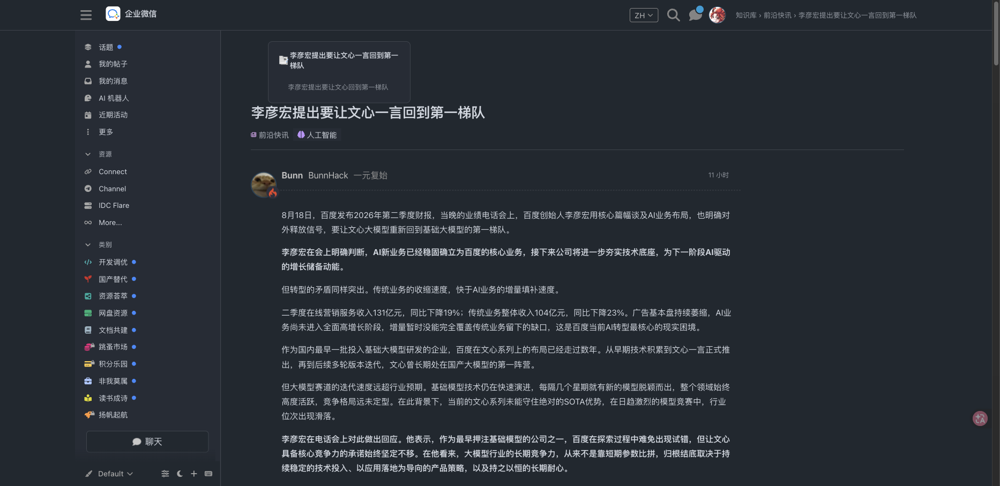

# Linux DO · 企业微信智能文档 / 团队知识库外观

油猴脚本：把 [linux.do](https://linux.do/) 深度改版为**企业微信智能文档 / 团队知识库**版式。**只换皮，不碰数据**：帖子、链接、按钮、分类、标签和原交互都完整保留。

- **主页**：知识库文件列表（行首 `#4b8cff` 蓝普通文档图标、压缩所有者头像、隐藏论坛大横幅与准则条、侧栏类别/标签清晰可用）。
- **话题页**：智能文档画布（中栏主帖大标题 + 协作者元信息 + 1.75 行高正文 + Callout 提示卡片，左栏正文 TOC 大纲，隐藏突兀时间线，回复流紧凑协作化）。
- **色彩与模式**：浅色跟企微；深色跟 GitHub Primer `dark_dimmed`（Soft dark `#212830`）+ 企微智能文档蓝。
- **架构保障**：零 DOM 挪动，绝不破坏 Discourse 原生 `post-stream` 虚拟滚动与无限加载。

## 效果图

### 知识库文件表（主页）


### 智能文档画布与大纲（话题页）



## 安装

1. 浏览器安装 [Tampermonkey](https://www.tampermonkey.net/)（或 Violentmonkey）。
2. 打开 [`linuxdo-wecom.user.js`](./linuxdo-wecom.user.js)，点 **Raw** 后按提示安装。
3. 访问 <https://linux.do/>。

开发：

```bash
npm test
npm run build
```

改 `wecom-*.mjs` / `wecom-style.css` 后必须 `npm run build` 再装生成的 `linuxdo-wecom.user.js`。

## 友链

[linux.do](https://linux.do/)
