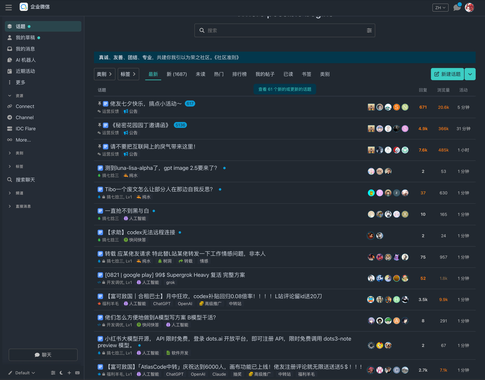
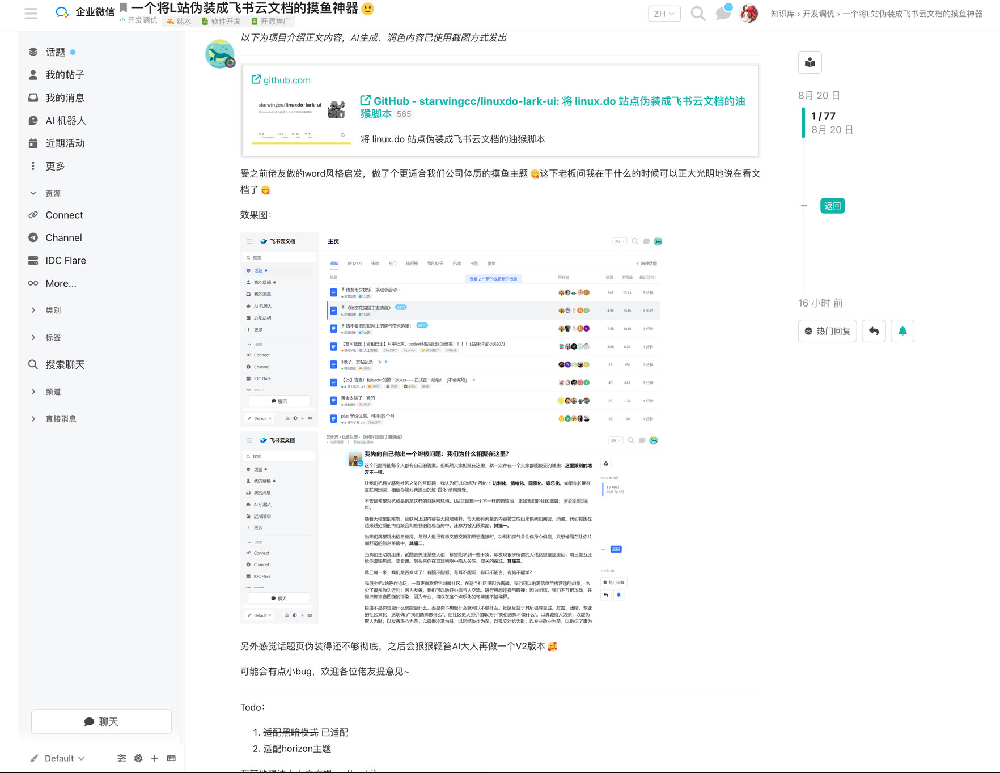

# Linux DO · 企业微信文档外观

油猴脚本：把 [linux.do](https://linux.do/) 换成企业微信文档风。**只换皮，不碰数据**：帖子、链接、按钮、分类、标签和原交互都保留。

浅色跟企微网页；深色跟 GitHub Primer `dark_dimmed`（Soft dark）。

## 效果图

主页浅色：


主页深色：



话题页深色：


话题页浅色：



发帖深色：


发帖浅色：


## 安装

1. 浏览器安装 [Tampermonkey](https://www.tampermonkey.net/)（或 Violentmonkey）。
2. 打开 [`linuxdo-wecom.user.js`](./linuxdo-wecom.user.js)，点 **Raw** 后按提示安装。
3. 访问 <https://linux.do/>。

开发：

```bash
npm test
npm run build
```

改 `wecom-*.mjs` / `wecom-style.css` 后必须 `npm run build` 再装生成的 `linuxdo-wecom.user.js`。

## 友链

[linux.do](https://linux.do/)
