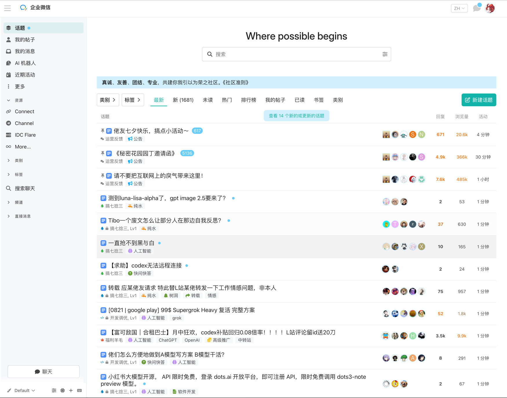
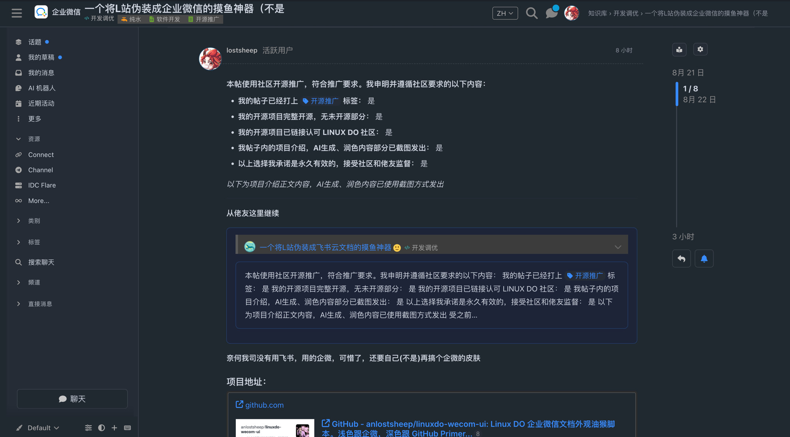
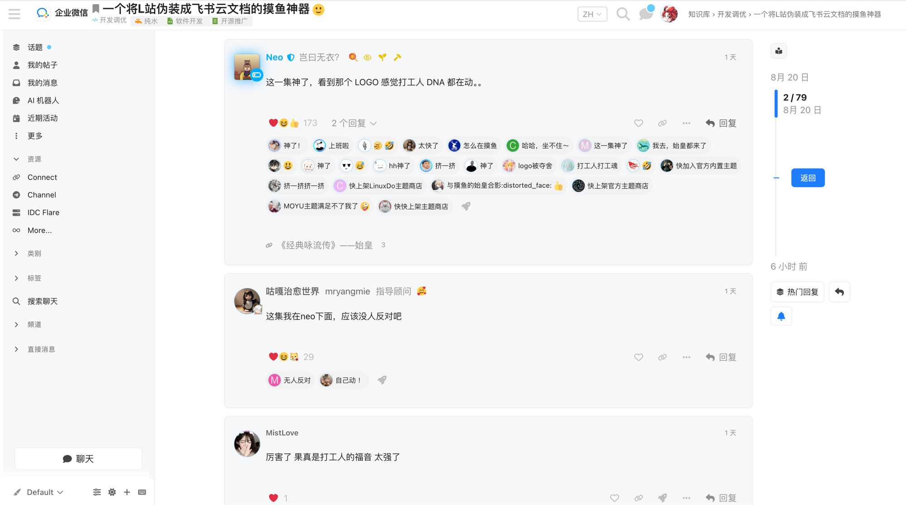
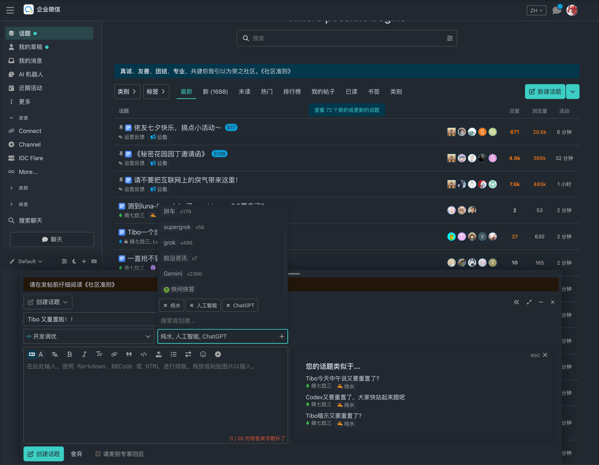
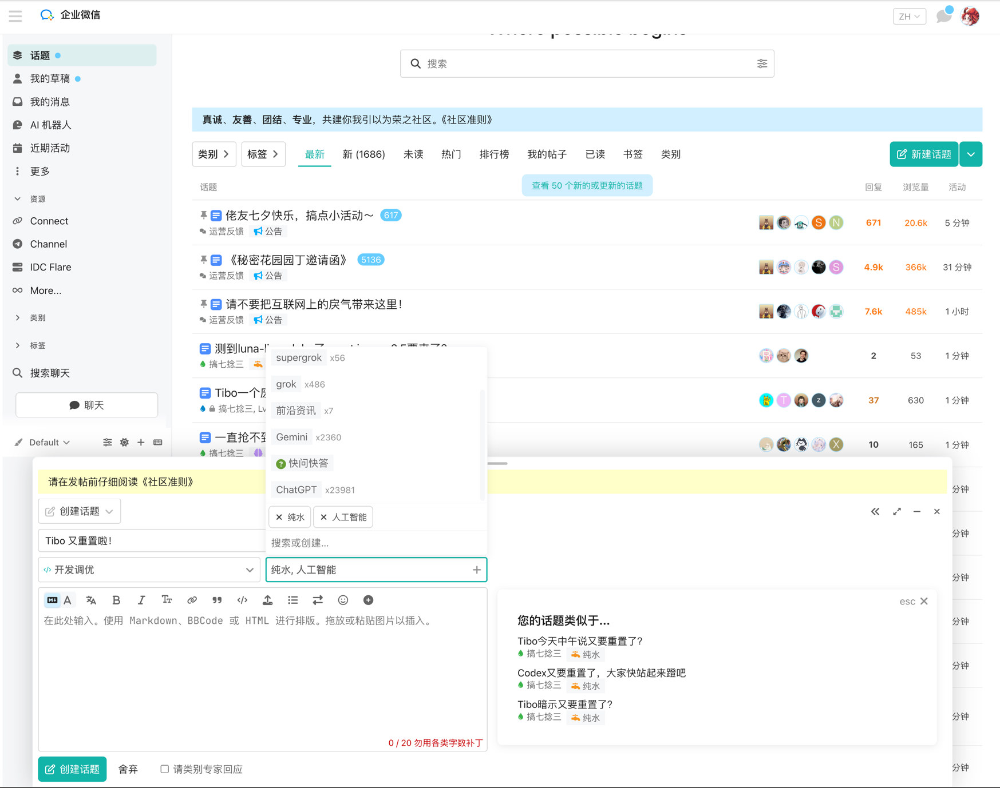
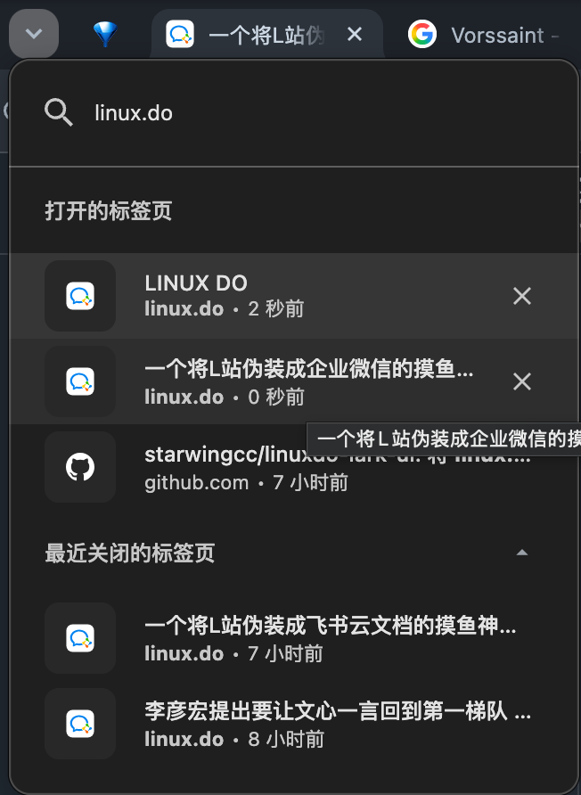

# Linux DO · 企业微信智能文档 / 团队知识库外观

油猴脚本：把 [linux.do](https://linux.do/) 改成**企业微信智能文档 / 团队知识库**版式。**只换皮，不碰数据**：帖子、链接、按钮、分类、标签和原交互都保留。

- **主页**：知识库文件表。行首蓝色普通文档图标，头像单行叠放，藏掉论坛大横幅；侧栏类别 / 标签可用。
- **话题页**：中栏当文档画布（大标题、协作者元信息、正文与 Callout）；回复做成正文下方的轻量卡片；右侧保留 Discourse 原生时间线 / 大纲（帖子本身有才会出现）。
- **顶栏**：官方企微图标 +「企业微信」；话题页路径为 `知识库 › 分类 › 标题`；标签页标题跟文档名走。
- **色彩**：浅色跟企微网页；深色跟 GitHub Primer `dark_dimmed`（`#212830`）+ 智能文档蓝。
- **架构**：不把回复搬出 `.post-stream`，不破坏 Discourse 虚拟滚动（只让主帖免于 cloak）和无限加载。
- **标签页**：后台标签页里 Discourse 改写标题也会被立刻改回，标签栏不露「LINUX DO」。

## 效果图

主页浅色：



话题页深色：



话题页深色（回复卡片与右侧时间线）：


话题页浅色（回复卡片与右侧时间线）：



发帖深色：



发帖浅色：



标签页图标：



## 安装

1. 浏览器安装 [Tampermonkey](https://www.tampermonkey.net/)（或 Violentmonkey）。
2. 打开 [`linuxdo-wecom.user.js`](./linuxdo-wecom.user.js)，点 **Raw** 后按提示安装。
3. 访问 <https://linux.do/>。

当前安装包版本 **2.0.8**。改 `wecom-*.mjs` / `wecom-style.css` 后必须重新构建再装：

```bash
npm test
npm run build
```

## 友链

[linux.do](https://linux.do/)
